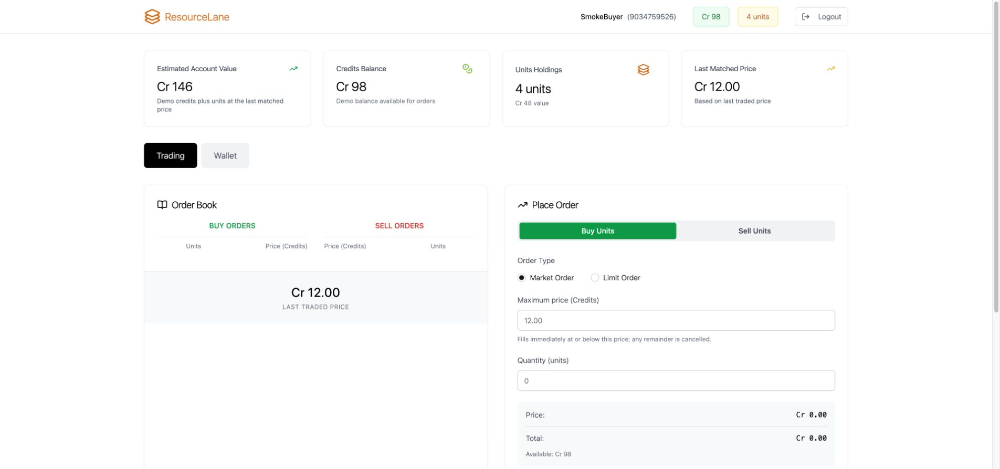
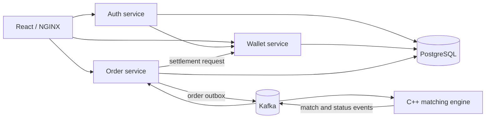

# ResourceLane

ResourceLane is an independently developed local learning prototype for matching orders for standardized resource units and settling them with **simulated credits**. A unit can stand for a fungible capacity entitlement or another standardized resource in a demo; this implementation runs one resource market. It does not process real payments or allocate physical inventory.

The stack is React, three Spring Boot services, a C++ matching engine, Kafka, PostgreSQL, Docker, and Kubernetes. Users register with a 10-digit demo account ID and TOTP, add demo credits or resource units, place buy and sell orders, cancel resting limit orders, and inspect matched trades.



These screenshots use synthetic accounts in a local Docker Compose run. The [trade history screenshot](docs/screenshots/trade-history.jpg) shows separate fills at Cr 12 and Cr 10. The [16-second two-account walkthrough](docs/demo-workflow.gif) is an eight-frame animation captured from the live UI: a seller lists one unit at Cr 12, a buyer places a matching order, and both accounts show the settled trade.

## System flow



The Java services share one local PostgreSQL instance. Kubernetes Services provide in-cluster DNS, while NGINX proxies browser API and WebSocket requests.

## Reliability work

- The order service saves an order and its pending Kafka event in one database transaction. A relay publishes the event and records broker acknowledgement.
- Orders and cancels are sent with one Kafka key to a single-partition `order` topic, so the matcher reads them in submission order. A cancel shares its order's outbox row and is published only after the order.
- Each matched order pair has a stable execution ID. The wallet commits the credit and unit transfer with a unique settlement marker; repeated Kafka delivery cannot repeat the same transfer.
- Placing an order reserves its maximum credits or units in the shared PostgreSQL transaction that creates the order and outbox event. Withdrawals exclude active reservations. A buy market order executes only up to the entered maximum price; its unmatched quantity is released after the completion event.
- The order service rejects an incoming order that could cross the same user's active opposite-side order before publishing it. Trade history stores each fill separately, preserving its execution price.
- The matcher saves resting orders, last price, recent message IDs, and the applied input offset to a persistent volume after Kafka confirms its outputs, then commits the offset. A message at or below the saved offset is skipped after a restart; the recent-ID window (`MATCHER_DEDUP_WINDOW`, default 10000) catches orders the outbox republished. A malformed order message is logged and skipped instead of stopping the matcher. Replayed status updates use absolute remaining quantities.
- Wallet credits use PostgreSQL `NUMERIC(19,2)`. Settlement records (`trade`, `status`) are retried while the wallet or database is unavailable; a record that fails validation moves to `trade.DLT` or `status.DLT` so it cannot block later settlements. Market data (`ltp`, `orderbook`) uses a consumer group per instance and skips a failed update.
- TOTP verification locks an account for 15 minutes after five wrong codes and refuses a code that was already used. NGINX rate-limits `/api/auth/verify` and does not route the internal settlement endpoint.
- Health endpoints are available to Kubernetes probes without a JWT. Business endpoints remain authenticated.

## Run locally with Docker Compose

Copy [.env.example](.env.example) to `.env`, replace the three placeholders, and keep `.env` outside Git. Then run:

```bash
docker compose up --build -d
```

After the three Java services have started, open `http://127.0.0.1:3000`. Run the end-to-end smoke test against the same address:

```bash
python3 scripts/smoke_k8s.py http://127.0.0.1:3000
```

The Compose stack uses named volumes for PostgreSQL, Kafka, ZooKeeper, and matcher state. The smoke test adds local demo data on each run.

## Run on local Kubernetes

Follow the [local Kubernetes guide](k8s/readme.md). The tested environment uses an isolated Colima profile on macOS. After the eight application Pods are Ready, forward the frontend:

```bash
kubectl --context colima-resourcelane -n resource-lane port-forward svc/frontend 8088:80
```

Open `http://127.0.0.1:8088`. In a second terminal, run:

```bash
python3 scripts/smoke_k8s.py http://127.0.0.1:8088
```

The smoke test creates two demo users, verifies TOTP and repeat login, funds the buyer with demo credits, gives the seller resource units, and checks limit-order settlement and trade histories. It also verifies that a buy market order respects its maximum price, releases the reservation when cancelled, and settles when the cap permits a match.

The GitHub Actions workflow runs the three Maven test suites, React lint/tests/build, and the C++ Docker build with CTest. You can run each Java suite with `./mvnw test` inside its service directory, and the frontend suite with `npm ci && npm run lint && npm test && npm run build`.

For local service metrics and searchable container logs, follow the [observability guide](k8s/observability/README.md).

For a future EC2, S3, and CloudFront deployment, see the [AWS deployment checklist](AWS_DEPLOYMENT.md). It has not been deployed or validated on AWS.

## Current limits

This local setup has one PostgreSQL instance, Kafka broker, and matching-engine replica. The matcher rewrites its whole snapshot after each order, so this design is not suitable for high-throughput workloads. PostgreSQL, Kafka, ZooKeeper, and matcher state need a coordinated recovery plan; losing one while retaining the others can prevent safe restart. Existing orders from an older schema have no reservations and need migration or a fresh demo database. The matcher and public price DTOs still use floating point values. Kafka output replay can duplicate price and order-book notifications. This is a portfolio and learning prototype, not a production marketplace.
